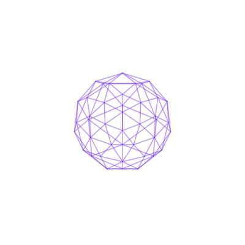

<!-- <p align="center">  -->
<div align="center">
  
</div>
<h1 align="center">Hey, I'm Juan 👋</h1>
<p align="center">Full Stack Developer · Docker, Astro, Angular, Spring Boot, .NET, C#</p>

<p align="center">
  <a href="https://juan.mingonzalez.com"></a>
  <a href="https://www.linkedin.com/in/juanmingonzalez/"></a>
</p>

## 💡 About me

I love learning new things 👀.

Before writing a single line of code, I've already spent a good while thinking through the problem.

What matters to me is understanding what's being built and why. I choose the stack afterwards, once I know what it needs to handle and what it needs to show the client.

I get along well with technical complexity. Even better at turning it into something that makes sense to the people using it.

```js
while (learning) {
  improve();

  if (!coffee) {
    throw new Error("Build failed: coffee not found ☕");
  }
}
```

## 🛠️ Skills

| | |
|---|---|
| **Frontend** | [](https://skillicons.dev) |
| **Backend** | [](https://skillicons.dev) |
| **Mobile** | [](https://skillicons.dev) |
| **DevOps & Tools** | [](https://skillicons.dev) |
| **Databases** | [](https://skillicons.dev) |


## 📊 Statistics


  


## 📫 Find me

[](https://juan.mingonzalez.com)
[](https://www.linkedin.com/in/juanmingonzalez/)
